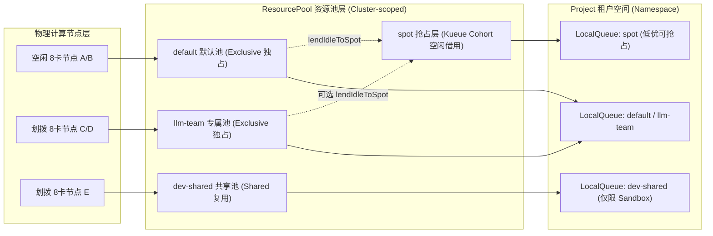

# Workspace 基础支撑扩展与资源池（ResourcePool）架构设计规划

> **状态**：待确认（Draft / Pending Review）
> **API Group**：`workspace.wutz.dev/v1alpha1`
> **参考对标**：NeoGPU（算力牛）算力资源池体系（主）、火山引擎机器学习平台 veMLP（辅）

本文档汇总了围绕 `workspace` 多租户与算力底座的架构讨论结论，涵盖**项目定位与命名决策、多项目与实例规格边界划分、参考 NeoGPU 的资源池（`ResourcePool`）核心设计、Node Label 与 Kueue 协同实现机制、周边底座扩展清单以及分阶段实施路线**，供确认后指导编码实现。

---

## 一、 架构关键决策汇总

### 1. 项目命名决策：保留 `workspace`（不重命名）
* **结论**：保持现有仓库名 `workspace` 与 Kubernetes API Group `workspace.wutz.dev` 不变，不再进行项目级重命名。
* **核心依据**：
  1. **保护公共契约稳定**：项目近期（`v0.5.x`）刚完成从 `project` 到 `workspace` 的全链路迁移。再次变更 API Group、Finalizers（`workspace.wutz.dev/*`）、RBAC 聚合标签（`workspace.wutz.dev/aggregate-to-member`）、ConfigMap（`workspace-platform`）以及镜像/Chart 发布路径会产生高昂的破坏性迁移成本。
  2. **领域语义高度契合**：行业主流 AI 平台（Databricks、Azure ML、Vertex AI、Kubeflow）均以 `Workspace` 定义“底层算力池绑定 + 多租户空间隔离 + 存储/镜像/网络边界 + 成员权限”基础层。在 `workspace.wutz.dev` 下承载 `ResourcePool`（算力供给）、`InstanceType`（规格目录）、`Project`（租户消费）三个核心 CRD 概念自洽。
  3. **工程矩阵层次清晰**：与现有产品家族形成清晰分层——集群基础设施层（如 `k8sforge`）管节点与集群，`workspace` 管集群之上的算力池化与租户空间，上层应用平台（如 `forgeai`、`agent-sandbox`）管开发机、训练与推理业务。
  4. **后续细节收敛**：仅需在迭代时顺手统一内部少量遗留命名文案（如文档标题或新增字段描述），不动公共 API 契约。

### 2. 实例规格（`InstanceType`）边界决策：不拆分独立项目
* **结论**：`InstanceType` 继续保留在 `workspace` 仓库内维护，**不拆分为独立项目**。
* **核心依据**：
  1. **配额与 Flavor 强耦合**：`ProjectReconciler` 依赖 `InstanceType` 计算出的单卡 CPU/Memory 切片推导 `ResourceQuota` 与 Kueue `ClusterQueue` 配额；两者共同维护并引用 Kueue `ResourceFlavor`。
  2. **共享配置与 API Group**：与 `Project`、`ResourcePool` 同属 `workspace.wutz.dev/v1alpha1`，共用 `workspace-platform` ConfigMap，代码体量轻巧（不足 500 行），拆分会显著增加跨仓 CRD 同步与部署运维负担。
* **仓内增强方向**：
  * 支持**「节点自动发现 + 静态声明/覆盖」双模式**（保留非 `managed-by=workspace` 的管理员自定义规格，支持纯 CPU 规格、缩容至 0 的弹性节点池规格及可见性控制）；
  * 在 `cmd/main.go` 提供控制器启停开关（如 `--enable-instancetype-controller`），保持 `api/v1alpha1` 轻量以便上层组件引用。

### 3. 多用途项目拆分策略（工程仓库层 & 集群租户层）
* **工程代码仓库层（分层适度拆仓，控制在 3~4 个核心项目）**：
  1. **基础支撑底座（`workspace`，即本仓库）**：只管算力池（`ResourcePool`）、实例规格（`InstanceType`）、多租户空间（`Project`）、配额队列、网络策略、成员身份及项目级基础资源（Harbor / 共享存储）开通，不侵入具体训练/推理业务。
  2. **交互式开发环境（Sandbox / DevBox）**：围绕 `agents.x-k8s.io`（`agent-sandbox`）演进，负责交互式容器、WebIDE/SSH 接入、**闲时自动关机释放算力保盘（Scale-to-Zero）**、换规格开机与保存镜像。
  3. **训练与在线推理编排层（Workloads）**：训练侧直接复用开源 Kubeflow Trainer v2（`trainer.kubeflow.org`）、JobSet、KubeRay + Kueue，自研仅做轻量 Webhook/适配层（自动展开 `InstanceType` 资源/亲和性、自动挂载共享盘）；推理侧初期共仓，待深入大模型多机 PD 分离（LWS/KServe）与灰度扩缩容时再按需独立。
  4. **上层平台控制面与资产中心（如 `forgeai`）**：负责控制台 UI、OpenAPI/CLI、镜像/数据集/模型仓库元数据、实验管理与监控计量大盘。
* **集群租户运行层（`Project` CR 划分原则）**：
  * **不建议**将同一算法团队按“开发、训练、验证”拆成多个 `Project` CR（否则会导致 Namespace、PVC 存储盘、Harbor 私有镜像仓和网络策略被割裂，开发机代码与镜像难以直接用于训练）；
  * **建议**按「业务团队 / 研发课题」建立单一 `Project`，在项目内通过绑定不同 `ResourcePool` / `LocalQueue` 承载开发与训练；**唯一例外**是生产高可用在线推理（Prod）与算法实验探索（Research）因安全与 SLA 隔离要求不同，建议拆分为独立的 `*-research` 与 `*-prod` Project。

---

## 二、 资源池（`ResourcePool`）架构设计（参考 NeoGPU 为主）

### 1. 现状痛点与目标架构演进
当前实现采用全集群扁平单池模型：所有同型号 GPU 节点归入单一 `ResourceFlavor`（`project-<class>`），无法物理圈定团队专属整机（易受零散 1 卡任务造成跨节点碎片，导致 8 卡任务有配额却拉不起），也无法划分多人复用的共享开发机节点。

引入参考 NeoGPU 的 `ResourcePool` 后，算力链路升级为 **`Node -> ResourcePool -> Kueue ResourceFlavor / InstanceType -> Project / LocalQueue`**：



### 2. 对标 NeoGPU 的四类算力池模型

| NeoGPU 概念 | `workspace` 池模式 | 节点归属与分配机制 | 允许的负载类型 | 核心调度与治理规则 |
| :--- | :--- | :--- | :--- | :--- |
| **默认资源池** | 系统内置 `default` 池（`mode: Exclusive`） | 未被任何具名池纳管的 GPU/CPU 节点自动归入 `default` 池 | 开发机、训练任务、在线推理 | **GPU 独占**（支持 1/2/4/8 卡切片）；支持多 `Project` 按配额共享；支持配置开发机闲时自动关机 |
| **专属资源池** | 具名 `ResourcePool`（`mode: Exclusive`） | 管理员将同一可用区内**完全空闲**的节点从 `default` 或其他池移入 | 开发机、训练任务、在线推理（可按池限制） | **物理节点隔离 + GPU 独占**（防外部碎片干扰整机训练）；按 `allowedProjects` 控制授权范围；支持闲时自动关机 |
| **共享资源池** | 具名 `ResourcePool`（`mode: Shared`） | 管理员将**完全空闲**的 8 卡节点移入，节点打专用污点并启用复用能力 | **仅限共享开发机（`Sandbox`）**；禁止训练与推理 | **GPU 复用模式**（如单 8 卡节点上限 `16` 台共享开发机，竞争显存与算力）；**不支持**闲时自动关机规则 |
| **Spot 资源** | 池级弹性借用层（`Spot` 队列） | **不单独圈占静态节点**，动态借用开启了 `lendIdleToSpot` 的独占池实时空闲容量 | Spot 开发机、容错训练、弹性推理 | **低优可抢占**（常规高优负载提交时立即驱逐回收）；支持配置**单次最大排队时长（1~12h）**与**最大重新排队次数（0~3次）** |

### 3. 核心实现机制：为什么采用「Node Label + Kueue 配额」双层协同？

资源池的实现**不能在 Node Label 与 Kueue 配额之间二选一**，必须采用**「Node Label 锚定物理池边界 + Kueue `ResourceFlavor` 桥接 + Kueue `ClusterQueue` 管控配额与抢占」**：

1. **为什么物理池边界必须靠 Node Label（+ Taint）？**
   * **防跨池整机碎片**：纯逻辑配额无法阻止其他池的 1 卡开发机散落在专属池的 8 卡机器上，导致 8 卡分布式训练虽有配额却找不到连续整机。
   * **隔离共享池节点属性**：`Shared` 池需要节点级 GPU Time-Slicing/复用插件配置以及 `NoSchedule` 专用污点（阻挡训练任务），这属于物理节点属性，纯 Kueue 配额无法表达。
   * **保障 RDMA 拓扑与无 Kueue 降级兼容**：圈定同可用区/同交换机节点边界，且在 `--enable-kueue=false` 降级模式下仍可通过 `nodeSelector` + `ResourceQuota` 保持池隔离。
2. **为什么池内分配与弹性必须靠 Kueue 配额？**
   * **一池多项目切分**：`default` 池或部门大池由多个 `Project` 按卡数配额共用，单靠 8 卡整机粒度的 Node Label 无法切分团队额度。
   * **排队与成组调度（Gang Scheduling）**：池满时挂起排队，避免多机任务半数 Pod 占卡死锁。
   * **Spot 免划拨借用与抢占**：无需修改物理节点的池标签，直接通过 Kueue `Cohort` + `WorkloadPriorityClass` 借用独占池空闲节点，并在正主需要时自动抢占驱逐。
3. **桥接方式（`ResourceFlavor` 升级）**：
   * `ResourcePoolReconciler` 为池内节点打上 `workspace.wutz.dev/pool=<pool>` 与 `workspace.wutz.dev/pool-mode=exclusive|shared` 标签（`Shared` 池附加 `workspace.wutz.dev/shared-pool=true:NoSchedule` 污点）；
   * 自动生成按池维度的 Kueue `ResourceFlavor`（命名如 `pool-<pool>-<gpu-class>`），其 `spec.nodeLabels` 同时匹配 `workspace.wutz.dev/pool` 与 `nvidia.com/gpu.product`（`Shared` 池 Flavor 附带对应 `nodeTaints` / `tolerations`）。

---

## 三、 拟新增与演进的 API 草案（概念模型）

### 1. 新增 `ResourcePool` CRD（Cluster-scoped）

```yaml
apiVersion: workspace.wutz.dev/v1alpha1
kind: ResourcePool
metadata:
  name: llm-exclusive
spec:
  displayName: 大模型团队专属池
  # Exclusive（独占模式，默认） | Shared（共享开发机复用模式）
  mode: Exclusive
  # 可选可用区约束，限制仅同可用区空闲节点可移入
  zone: cn-north-1a
  # 显式划入本池的节点列表（未归入任何具名池的节点自动归属内置 default 池）
  nodes:
    - gpu-h100-node-01
    - gpu-h100-node-02
  # 允许运行的负载类型；Shared 模式下校验强制仅允许 [Sandbox]
  allowedWorkloads:
    - Sandbox
    - TrainJob
    - Inference
  # 仅 mode=Shared 时配置：单节点共享开发机槽位上限（如单 8 卡节点最多 16 台）
  sharing:
    maxInstancesPerNode: 16
  # 仅 mode=Exclusive 时配置：是否将空闲算力贡献给全局 Spot 队列借用
  spotPolicy:
    lendIdleToSpot: true
  # 授权范围控制：Public（所有获配额项目可用） | Restricted（仅白名单 Project 可绑定）
  accessControl:
    visibility: Restricted
    allowedProjects:
      - demo
  # 池级自动化规则（仅 Exclusive 池支持，Shared 池禁止开启）
  rules:
    idleShutdown:
      enabled: true
      idleDuration: 2h
      countdownDuration: 30m # 枚举：0m / 15m / 30m / 45m / 60m
status:
  totalNodes: 2
  readyNodes: 2
  # 按 GPU Class 汇总本池容量与空闲卡数
  gpus:
    - class: h100-80gb
      total: 16
      allocated: 8
      free: 8
  # 考虑单节点连续卡碎片后的各规格真实可立即启动实例数（对标 NeoGPU 可启动数量）
  launchable:
    - instanceType: h100-80gb.x1
      count: 8
    - instanceType: h100-80gb.x8
      count: 1
  conditions:
    - type: Ready
      status: "True"
      reason: Ready
```

### 2. `Project` CRD 池化配额扩展（完全向后兼容）

* **兼容规则**：原有 `spec.quota.gpus` 保持不变，未配置 `poolQuotas` 时默认等价于绑定内置 `default` 资源池，存量清单零改动。
* **多池与 Spot 扩展草案**：

```yaml
apiVersion: workspace.wutz.dev/v1alpha1
kind: Project
metadata:
  name: demo
spec:
  displayName: Demo project
  # 新增：按资源池分配配额（支持同时使用专属池、默认池与共享开发机池）
  poolQuotas:
    - pool: llm-exclusive
      gpus:
        - class: h100-80gb
          count: 16
    - pool: dev-shared
      maxSandboxes: 8
  # 新增：Spot 资源权限与排队重试策略（对标 NeoGPU Spot 自动排队规则）
  spot:
    enabled: true
    gpus:
      - class: h100-80gb
        count: 8
    maxQueueDuration: 4h   # 单次最大排队等待时长（1h ~ 12h）
    maxRequeueCount: 2     # 被抢占或资源不足允许重新入队次数上限（0 ~ 3）
  quota:
    storage: 2Ti
    volumes: 20
    registryStorage: 200Gi
```

* **生成对象变化**：
  * `ProjectReconciler` 为每个获授的 `ResourcePool` 在项目 Namespace 下维护对应的 `LocalQueue`（如 `default`、`llm-exclusive`、`dev-shared`、`spot`）及背后的 `ClusterQueue`；
  * `project:project:<name>` `ClusterRole` 自动按绑定关系收敛成员可读的 `ResourcePool` `resourceNames`——未授权的资源池对普通成员天然不可见（精准对齐 NeoGPU「权限策略 + 授权范围」体验）。

### 3. 节点移入/移出空闲守卫规则
* 当管理员修改 `ResourcePool.spec.nodes` 尝试移入或移出某台节点时：
  1. **可用区一致性校验**：若池声明了 `zone`，校验目标节点的 `topology.kubernetes.io/zone` 必须匹配；
  2. **空闲状态强校验（Validating Webhook / 控制器守卫）**：检查目标节点是否存在运行中的非系统工作负载 Pod（`usedGPU > 0` 或存在活跃 `Sandbox`）。若非空闲，拒绝移出/切换池并在错误信息（或 `NodeTransferBlocked` Condition）中列出当前占用该节点的 Project 与工作负载明细，防止运行中业务被切断或跨池账实不符。

---

## 四、 对标火山引擎 MLP 与 NeoGPU 的周边底座补齐清单

除 `ResourcePool` 核心改造外，作为完整的基础支撑层，规划按优先级扩展以下周边能力：

### P0（与资源池同期或紧随其后建设）
1. **网络策略内网基础设施白名单**：修复当前 `denyInternet: true` 阻断集群内部基础设施访问的问题，在 `workspace-platform` ConfigMap 的 `network` 中增加 `allowedEgressCIDRs` / `allowedEgressNamespaces`，确保禁公网项目仍可正常访问内部 Harbor 镜像仓、对象存储（S3/MinIO）、内部 PyPI/HF 镜像源与 K8s API。
2. **多级负载优先级与硬件拓扑支撑**：
   * 预置标准 `WorkloadPriorityClass`（在线推理不可抢占 > 独占开发机 > 常规训练 > Spot 可抢占）；
   * 支持在规格与配额中透传 RDMA 网卡资源（如 `rdma/*`）、共享内存（`/dev/shm`）以及节点硬件故障污点自动剔除。
3. **纯 CPU 实例规格与非 NVIDIA 扩展预留**：支持在无卡节点或通用池推导/声明纯 CPU `InstanceType`，供数据预处理与轻量调试使用。

### P1（存储、镜像与身份安全闭环）
4. **项目共享存储卷与公共数据集投射**：
   * 支持按 `StorageClass` 细分存储配额；支持为每个 `Project` 自动制备默认 RWX 共享盘（如 `workspace-shared`，供项目内开发机与训练任务无缝共享代码和权重）；
   * 支持将平台公共只读数据集 / 基础大模型权重安全投射至授权 `Project` Namespace；落实 `TrashRetention` 回收机制。
5. **权限收口与外部身份（OIDC）对接**：
   * `Member` 支持绑定外部 OIDC `User` / `Group`，支持短期/可轮换访问凭证；
   * 收窄 `edit` 角色对 Namespace 内 `secrets` 的全量 `list/watch` 权限，隔离平台托管凭证与用户自定义密钥；
   * 增加项目级 `admin`（项目维护者）角色，支持自助管理项目成员而不越权修改配额。
6. **镜像体系增强**：在 `workspace-platform` 增加默认 `registryStorage` 配额上限兜底；自动为项目配置平台公共预置基础镜像项目（`base-images`）的只读拉取权限。

### P2（可观测性与计量）
7. **分池/分项目真实利用率与计量指标**：暴露各 `ResourcePool` 与 `Project` 的分配率、排队水位、结合 DCGM 的真实 GPU 计算/显存活跃度指标，以及支撑成本核算的 `GPU·时` / `存储·时` 计量事件。

---

## 五、 分阶段编码实施路线（待确认后启动）

* **Phase 1：默认池与专属池底座闭环**
  * 脚手架生成 `ResourcePool` CRD，实现内置 `default` 池自动兜底与具名 `Exclusive` 专属池控制器；
  * 实现节点标签编排、节点空闲移入/移出校验、按池 `ResourceFlavor`（`pool-<pool>-<class>`）生成及分池 `launchable` 可启动实例数计算；
  * 扩展 `ProjectSpec.poolQuotas` 与按池 `LocalQueue` / RBAC 授权范围收敛，保持存量 `spec.quota.gpus` 100% 兼容，补齐 `envtest` 单元测试。
* **Phase 2：共享开发机池与池级自动化规则**
  * 实现 `ResourcePool` 的 `Shared` 模式（节点专用 Taint、单节点共享实例槽位配额控制、仅允许 `Sandbox` 投递校验）；
  * 落地 `ResourcePool.spec.rules.idleShutdown` 配置schema与状态同步，供 `agent-sandbox` 读取执行闲置倒计时关机。
* **Phase 3：Spot 抢占借用与周边底座能力（网络白名单 / 共享存储）**
  * 实现 `WorkloadPriorityClass`、独占池空闲容量向 Spot Cohort 借用抢占，以及单次排队时长（1~12h）与最大重入队次数（0~3次）控制；
  * 落地 `denyInternet` 内网白名单、平台默认 Harbor 存储配额与项目默认共享存储卷。

---

## 六、 待确认事项（Review Checklist）

在正式开始 Phase 1 编码前，请确认以下细节是否符合预期：
1. **默认池命名与兼容策略**：系统内置默认池命名为 `default`，当 `Project` 只写了旧版 `spec.quota.gpus` 时自动映射到 `default` 池，是否认可？
2. **共享资源池（`Shared`）底层复用选型**：集群侧共享开发机节点计划采用 **NVIDIA GPU Plugin Time-Slicing**（每张卡暴露多份逻辑卡）、**HAMi（显存/算力软硬限额）**，还是像 NeoGPU 一样**挂载整机 8 卡设备但通过自定义扩展资源槽位（如 `workspace.wutz.dev/shared-slot: 16`）控制单机最多 16 台**？
3. **节点移入/移出方式**：`ResourcePool` 通过显式节点名列表 `spec.nodes: [...]` 划拨机器（最贴合控制台勾选机器移入/移出的操作），是否需要同时支持自定义 `nodeSelector` 动态匹配？
